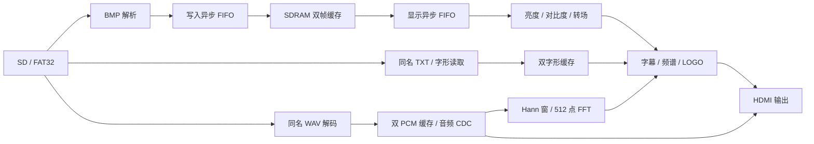

# FPGA HDMI 多媒体播放器


基于安路 HX4S20 开发板和 EG4S20BG256，实现 SD 卡图片、同名配音与中文字幕播放。工程顶层为 `hdmi_player_board_top`，TD 工程入口为 [HDMI_Player.al](project/td/HDMI_Player.al)。


## 1. 功能


| 功能 | 实现 |

|---|---|

| 图片播放 | FAT32 根目录 BMP 枚举、24 位图像解析、上一张/下一张与首尾循环 |

| 帧缓存 | SDRAM 双帧缓存，后台写入，显示端按帧切换 |

| HDMI | 640×480 输出，约 60 Hz，输出连接器 A |

| 图片控制 | 亮度、对比度调整，5 秒自动轮播，16 级淡出淡入 |

| 图片配音 | 图片与同名 WAV 配对，转场开始时重播对应配音 |

| 音频控制 | 20 档音量、暂停、静音，左上角显示配音播放时间 |

| 中文字幕 | 同名 UTF-8 TXT，按需读取 SD 字库，最多 64 个字符 |

| 字幕控制 | 显示开关、短按步进、长按滚动、双键归零，切图保持滚动状态 |

| 音频可视化 | 512 点 FFT、16 段频谱，独立显示开关 |

| LOGO | 右上角 64×64 固定图案与透明背景 |


## 2. 工程结构


```text

FPGA_HDMI_Player/

├── README.md                    项目说明、接线、构建与验证

├── constraints/                 ADC 引脚约束、SDC 时序约束

├── include/                     公共参数

├── project/td/HDMI_Player.al     TD 工程入口

├── rtl/

│   ├── top/                     板级封装、系统顶层、导航与轮播

│   ├── storage/                 SD、FAT32、BMP、WAV、TXT

│   ├── memory/                  FIFO、跨时钟描述、SDRAM 读写与刷新

│   ├── display/                 HDMI、字幕、频谱及视频时钟 IP

│   └── ip/                      内存时钟和厂商 SDRAM IP

├── assets/

│   ├── logo/                    LOGO 原图

│   └── sd_card/                 可复制到卡根目录的演示素材与字库

├── licenses/                    第三方代码及字库许可

```


## 3. 数据通路





Storage 以 `pixel_valid && pixel_ready` 完成像素传输。Memory 接收帧描述，缓存写入完成并排空下游后发布完成状态。显示读取通过仲裁与刷新共享 SDRAM。


地址使用 32 位字单位，每个字存放一个 RGB888 像素。默认两帧基址为 0 和 307200，帧槽均按 640×480 像素预留。应用读写按四字组交接。


字幕先写入非显示字形缓存，实际图片更换通知到达后在视频帧边界发布。图片加载失败会取消待发布字幕。切图保留滚动方向、暂停状态及位置，较短文字按新周期折回位置。


## 4. 开发环境和时钟


| 项目 | 配置 |

|---|---|

| FPGA | EG4S20BG256 |

| 综合与实现 | Tang Dynasty 6.2.168116 |

| 仿真 | ModelSim SE-64 2020.4，Icarus Verilog |

| 脚本 | Python 3.10 或更高版本 |

| 系统输入时钟 | 50 MHz，R7 |

| Memory 时钟 | 100 MHz |

| SDRAM 转发时钟 | 100 MHz，306° |

| 视频时钟 | 像素 25 MHz，串行器 125 MHz |

| 验证环境 | Windows，工具安装路径可由参数或环境变量配置 |


厂商的 `EG_PHY_SDRAM_2M_32` 由 TD 器件库提供。项目同时包含上层加密 SDRAM 控制器源码。RTL 的时钟生成定义与 `.ipc` 配置位于 `rtl/ip/` 和 `rtl/display/ipsrc/`。


## 5. SD 卡素材规则


```text

SD 卡根目录/

├── 救灾.BMP

├── 救灾.WAV

├── 救灾.TXT

├── 军事.BMP

├── 军事.WAV

├── 军事.TXT

├── 睡眠.BMP

├── 睡眠.WAV

├── 睡眠.TXT

├── 音乐.BMP

├── 音乐.WAV

├── 音乐.TXT

└── FONT16.BIN

```


| 类型 | 输入要求 |

|---|---|

| SD 文件系统 | FAT32，支持超级软盘式卷及 MBR 中的 FAT32 主分区 |

| BMP | 24 位 BI_RGB，支持从顶向下或从底向上存储 |

| 尺寸 | 宽度 4～640 且为 4 的倍数，高度 1～480 |

| WAV | RIFF PCM，48 kHz、16 位、双声道 |

| TXT | UTF-8，支持 BOM，最多 64 字符，读取开头 512 字节 |

| 命名 | 按 FAT 8.3 基本文件名关联 BMP、WAV 和 TXT |


推荐基本文件名使用最多 8 个英文或数字字符。当前播放顺序来自根目录中 BMP 的枚举顺序。


每张图片加载自己的同名 TXT。TXT 缺失、为空或字形读取失败时，字幕回退到图片序号、短文件名和尺寸。字库未收录的字符使用替代字形。换行和制表符按空格处理。


每张图片自动播放同名 WAV。手动切图会从对应配音开头播放。关闭轮播时当前配音循环播放，开启轮播时按实际转场开始锚定 5 秒节拍。SD 读取延迟会影响转场准备时间。


暂停只暂停音频及其播放时间，轮播继续计时。暂停期间切图，新图片的配音停在开头等待恢复。静音时配音及时间继续推进。时间字幕显示音频播放进度。


### 字库和 LOGO


`FONT16.BIN` 采用 Unicode 码点乘 32 的索引方式，每字 16 行，每行两个大端字节，总大小 34 MiB。字形来源和授权见 [FONT16-NOTICE.txt](licenses/FONT16-NOTICE.txt)。


```powershell

python scripts/build_sd_font.py unifont.hex.gz unifont_upper.hex.gz --output build/font

python scripts/gen_logo_rom.py --bmp assets/logo/my_logo.bmp --tolerance 12 rtl/display/src/logo_rom.v

```


LOGO 的默认范围为 x=568～631、y=8～71，位于最终叠加层。更换 LOGO 并重新生成 ROM 后，需要重新构建 bit。


## 6. 按键、拨码和引脚


所有控制输入使用低电平有效逻辑。外接常开按键一端接对应 GPIO，另一端接 J1-12 或 J1-30 的 GND。


| 板上位置 | 引脚 | 功能 |

|---|---|---|

| SW1 | C8 | 显示或隐藏音频播放时间 |

| SW2 | C7 | 显示或隐藏底部字幕 |

| SW3 | C6 | 有效档开启 5 秒轮播，拨回关闭 |

| SW4 | C5 | 整机复位 |

| KEY1 | A2 | 音量减 |

| KEY2 | B2 | 音量加 |

| KEY3 | B1 | 下一张 |

| KEY4 | C1 | 上一张 |

| J1-1 | D14 | 加载或重新加载当前图片 |

| J1-2 | G11 | 对比度减 |

| J1-3 | G12 | 对比度加 |

| J1-4 | F13 | 亮度减 |

| J1-5 | H13 | 亮度加 |

| J1-6 | H14 | 保持有效电平暂停音频及时间，释放后继续 |

| J1-7 | J14 | 静音，配音与时间继续推进 |

| J1-8 | J13 | 短按左移 16 像素并暂停滚动，长按约 0.5 秒启动左滚 |

| J1-9 | K12 | 短按右移 16 像素并暂停滚动，长按约 0.5 秒启动右滚 |

| J1-8 和 J1-9 同时按 | J13 / K12 | 字幕归零并暂停 |

| J1-13 | M14 | 频谱显示开关 |


SW3 开启档下复位后，控制器会经同步和消抖恢复轮播。


| LED | 含义 |

|---|---|

| LED1 / A4 | Memory 初始化就绪 |

| LED2 / A3 | SD 卡初始化完成 |

| LED3 / C10 | 前台图像有效 |

| LED4 / B12 | 错误锁存，复位后清除 |


| 接口 | 引脚 |

|---|---|

| SD CS / SCK / MOSI / MISO | A12 / A14 / A13 / B14 |

| HDMI CLK_P / D0_P / D1_P / D2_P | K1 / F5 / E3 / B3 |


完整约束位于 [ADC](constraints/hx4s20_hdmi_player.adc) 和 [SDC](constraints/hx4s20_hdmi_player.sdc)。


## 7. 硬件实现验收


| 资源 | 使用量 | 占用率 |

|---|---|---|

| LUT | 17487 / 19600 | 89.22% |

| 寄存器 | 8459 / 19600 | 43.16% |

| BRAM9K | 52 / 64 | 81.25% |

| BRAM32K | 0 / 16 | 0% |

| DSP | 16 / 29 | 55.17% |

| PLL | 2 / 4 | 50% |

| PAD | 35 / 188 | 18.62% |


采用 seed7，建立时间最差裕量为 +0.168 ns，汇总最小裕量为 +0.023 ns。共 25069 项端点检查无负裕量，包括 SDRAM DQ 读写各 64 项。


读控制器的下一组数据范围预判提前寄存，切断行计数、算术比较、仲裁与写状态机串联的长路径。修复前后 3958 个周期的外部输出逐拍一致。


厂商 IP 与原始 SDRAM 模型下，完整双帧缓存压力测试通过 7 帧、2150400 像素比对。生产时钟读回通过 768 像素、6 帧，Z 字为 0。空闲、持续写入、写后暂停三种刷新场景各观察到 34 次实际刷新。整机通过 9 次手动/轮播切图和字幕持续滚动检查。


整理版已重新执行综合、布局布线、hold 修复、bitgen 和时序端点审计，发布目录采用本次生成的 bit。资源和时序摘要见 [发布清单](release/manifest.json)、[资源报告](release/reports/resources.area) 和 [时序审计](release/reports/timing_audit.json)。


整理版已重新通过 14 组快速回归、整机音画字幕回归，以及真实 SDRAM IP 的读回和三种刷新场景。读回 768 像素，错误与 Z 均为 0。逐项结果见 [回归记录](release/reports/regression.json)。


当前时序裕量较小。后续修改源码、参数、器件或布局设置后，需要重新构建和审计。实物持续轮播、音频播放及掉电配置验收待完成。仿真保留既有未连接输出提示，TD 保留封装 SDRAM 位置和局部时钟提示。SD/HDMI 外部接口电气预算以实物验收为准。


## 8. 第三方来源与目录参考


FFT 适配来源及 MIT 授权见 [sound2fft-MIT.txt](licenses/sound2fft-MIT.txt)。内置字形和 SD 字库授权见 [subtitle-font-OFL.txt](licenses/subtitle-font-OFL.txt)、[Unifont-OFL-1.1.txt](licenses/Unifont-OFL-1.1.txt) 及同目录的原始许可文本。厂商 IP 和 SDRAM 模型保留原始声明。


目录组织参考了以下公开工程。


- HDL Util 将 HDMI 源码、顶层、仿真和测试分区。[hdl-util/hdmi](https://github.com/hdl-util/hdmi)

- Verilog Ethernet 分设 RTL、测试、综合与脚本目录。[alexforencich/verilog-ethernet](https://github.com/alexforencich/verilog-ethernet)

- Project F 按公共库和应用示例组织图形工程。[projf/projf-explore](https://github.com/projf/projf-explore)


