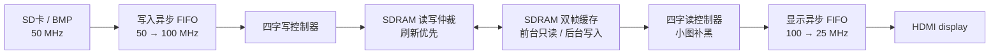

# 当前工程结构

2026-11-03最新：图片信息字幕和音频播放进度已接通；SW2控制底部图片序号/短文件名/尺寸，SW1控制左上角音频HH:MM:SS。J1-8/9短按左右步进、长按自动滚动，同时按回到起点。20档音量、轮播、频谱均保留。详见[字幕与播放进度](SUBTITLES.md)；尚未上板。以下记录按其日期与版本理解。


2026-11-02最新：已新增J1-13/M14常开频谱按键（另一端GND12/30），按一次开、再按关；播放WAV时在右下角显示512点FFT／16柱频谱，音量与两路静音反映到柱形，音频关闭时隐藏。保留main全部现有控制与J1-10轮播。最新bit及验证见[音频频谱](AUDIO_SPECTRUM.md)，尚未上板。以下旧记录按其版本理解。


2026-11-02合并main后最新接线：用户选择采用队友main布局。SW4(C5)复位、SW3(C6)音频开关、KEY1/2音量减/加、KEY3/4下一张/上一张；J1-1加载，J1-2..5对比度/亮度，J1-6与7静音，J1-10(L14)轮播。SW1/SW2字幕接口暂未启用。原先SW1复位、SW4静音、J1-1/2切图、J1-3轮播的说明均为旧版本。接线、含义、冲突处理与本次新bit见[main按键布局](MAIN_KEY_LAYOUT.md)。


2026-11-02最新补充：已增加J1-3/G12常开轮播按键（另一端GND），按一次开启每张完全显示后计时五秒的自动循环，再按停止；原J1-1/2手动切图保留。板级默认启用16帧淡出—黑场换缓存—16帧淡入，单侧约0.269秒。当前41源，新bit为`FFF/slideshow_transition_20261102/HDMI_Player_slideshow_fade_20261102.bit`，setup +0.288ns、hold +0.023ns，仿真及构建通过，尚未上板。接线、操作、变更与验证见[五秒轮播与淡入淡出](SLIDESHOW_FADE.md)。以下旧版本说明作为历史记录，以本段最新状态为准。


2026-11-02补充：已修复旧末图编号缓存导致的两图循环条件；最新40源工程bit及验证记录见 [IMAGE_SWITCH_FIX.md](IMAGE_SWITCH_FIX.md)。最新setup +0.192ns、HWNS +0.023ns，音频及原功能保留；尚待实板复测。以下保留此前版本的功能说明与构建记录。

更新：2026-11-01，增加SD卡WAV背景音频/共享扇区仲裁，保留外接GPIO循环切图和图像调整功能。

主工程入口是 `project/td/HDMI_Player.al`，板级顶层是 `hdmi_player_board_top`，系统核心是 `hdmi_player_top`。该清单明确选择 40 个 Verilog / VHDL 文件，不要递归添加整个 `rtl/display`，否则会加入同名参考副本。

```text
FPGA_HDMI_Player/
├─ rtl/
│  ├─ top/hdmi_player_board_top.v    SW1复位、SW2重载、J1外接切图、状态LED
│  │      image_navigation_ctrl.v    图片索引、排队、首尾循环、失败回退
│  │      hdmi_player_top.v          系统请求、错误处理、storage/memory/display 连线
│  ├─ storage/                      SD SPI → FAT32 → BMP → RGB888
│  ├─ memory/
│  │  ├─ memory_top.v               memory 总装与复位、跨时钟连接
│  │  ├─ async_fifo.v               通用异步 FIFO，含写域保守水位
│  │  ├─ frame_desc_cdc.v           50 MHz → 100 MHz 帧描述、完成状态返回
│  │  ├─ sdram_write_ctrl.v         四字预取、写地址和写完成
│  │  ├─ frame_buffer_ctrl.v        SDRAM 双帧缓存、消隐切换、失败帧清理
│  │  ├─ sdram_app_arbiter.v        读写整组仲裁、显示低水位优先
│  │  ├─ sdram_read_ctrl.v          四字读回、光栅输出和小图补黑
│  │  ├─ display_pixel_fifo.v       100 MHz → 像素域 FIFO、输出预取和欠载处理
│  │  ├─ sdram_refresh_ctrl.v       周期刷新、排空和超时保护
│  │  └─ sync_fifo.v               保留的同步 FIFO，当前主通路未例化
│  ├─ ip/
│  │  ├─ clk_pll/                  SDRAM PLL：100 / 100 / 100 MHz，转发306°
│  │  └─ sdram/                    厂商 sdr_as_ram / init_ref / wrrd 加密 IP
│  └─ display/
│     ├─ src/                      主工程采用的显示、音频、OSD 源码
│     │  ├─ hdmi_tx_display.v      显示组件、像素时钟与复位输出
│     │  ├─ read_RAM.v             640×480 时序，每个有效像素消费一次
│     │  ├─ hdmi_tx.vhd            VHDL 包装层，必须加入 TD 文件清单
│     │  └─ enc/                   HDMI / TMDS 编码和串行输出
│     ├─ ipsrc/clock_ip/clk_wize.v 显示 PLL：125 / 25 MHz，导出锁定状态
│     ├─ tb/                       队友的显示专项测试
│     ├─ docs/                     队友的音频和字幕说明
│     ├─ tools/                    字库生成工具
│     └─ README.md                 当前源码与历史资料导航
├─ archive/display_legacy/         puresrc、旧独立工程、旧 IP、构建产物和日志（不编译）
├─ include/global_def.v            SDRAM 数据宽度、地址宽度和时钟周期
├─ project/td/HDMI_Player.al        当前系统 TD 工程、40 个源码文件
├─ constraints/                   HX4S20 ADC管脚与SDC时序约束
├─ tb/memory/                     既有 FIFO / writer 测试
├─ verification/display_memory_20261028/  本次可重复执行的集成测试
└─ docs/                          进度、接口、复位、刷新与本次设计说明
```

实际数据方向：



`puresrc`、历史构建产物和原独立工程已原样归档到 `archive/display_legacy/`，详见[归档说明](../archive/display_legacy/README.md)。后续维护系统请修改主工程清单采用的 `rtl/display/src` 和 `rtl/display/ipsrc/clock_ip`。原来已经被本地删除的 `hdmi_demo_top.v` 未恢复，系统也不依赖它。

设计、接口限制及验证结果见 [DISPLAY_MEMORY_INTEGRATION.md](DISPLAY_MEMORY_INTEGRATION.md)。

板级使用方式与尚未收敛的写地址时序见 [BOARD_CONSTRAINTS.md](BOARD_CONSTRAINTS.md)。

写控制器现在在帧开始分拍准备首行地址，正常写入逐字/逐行递增，见 [ADDRESS_TIMING_FIX.md](ADDRESS_TIMING_FIX.md)。

当前时序与生产PLL验证结论以 [SDRAM_TIMING_CLOSURE.md](SDRAM_TIMING_CLOSURE.md) 为准。

当前接线、循环行为与可重复测试见 [GPIO_NAVIGATION.md](GPIO_NAVIGATION.md)，新增测试在 `verification/gpio_navigation_20261101/`。

音频旁路：同一 SD SPI 主机经 `sd_sector_arbiter` 分配给 BMP 与 WAV 文件上下文，WAV 经 `wav_stream_decoder` → `pcm_sample_fifo` → 48kHz 提交 → Display 音频FIFO/HDMI打包。模块位于 `rtl/storage/`，主控制为 `wav_audio_player.v`；不占SDRAM图片帧缓存。新增测试在 `verification/wav_audio_20261101/`，SW3/SW4及格式、错误码、bit见 [WAV_AUDIO.md](WAV_AUDIO.md)。
