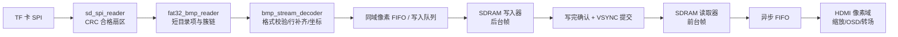

# 赛题一：SD/FAT32/BMP 存储子系统设计与争奖路线

版本：2026-10-24。对应上游 main 提交 `41fd53d66b70ed13e3870a5a7b7c092cd617401d`。

## 1. 结论与完成边界

推荐路线是“先稳定的 FAT32 图片播放器，再做可量化的显示增强”。你的 storage 部分已经形成可仿真的完整 RTL 链路：SD v2 SPI 初始化与单扇区读取、CRC 校验、FAT32 根目录枚举、碎片簇链追踪、BMP 解析、携带坐标和地址的像素输出。五个核心 RTL 文件，另附独立板级验证顶层，配套五组自检查仿真。

**当前交付是通过功能仿真的实现，不是已通过板级验收的成品，也不能承诺奖项。** 2026-10-24 已收到并核对原理图、参考工程与 SD 引脚，新增独立板级顶层及 TD 起始工程，见 [板卡核对与首次上板](hx4s20c_board_integration.md)。TD 已完成独立存储顶层的综合、布局布线、50 MHz 内部时序检查和候选码流生成；外部 SD 时序、实际上板和队友最终 SDRAM 接口仍待验证。整机资源、最高稳定工作频率、实卡兼容率和连续运行时间仍不得写成已验证成绩；已测独立顶层数据以 TD 验证记录为准。

## 2. 仓库原来有什么

仓库：https://github.com/3164010024ziyu-commits/FPGA_HDMI_Player

| 默认 main 中原有文件 | 实际内容与状态 |
| --- | --- |
| `README.md` | 功能规划、storage/memory/display 分工、目录约定；不是功能完成证明 |
| `rtl/memory/sync_fifo.v` | 同步 FIFO，注册读出，`rd_valid` 表示有效读；单时钟，不能直接做 CDC |
| `tb/memory/sync_fifo_tb.v` | 当前激励为三个字节写入再读取，以波形观察为主 |
| `docs/sync_fifo.md` | 队友记录的 FIFO 设计及综合说明；其综合数字属于 FIFO，不能套用于 storage |
| `rtl/display/display.v` | 空模块 `module display(); endmodule` |
| `project/td/HDMI_Player.al` | EG4S20BG256，TD 6.2 工程；只添加 FIFO，并以 `sync_fifo` 为顶层；含队友机器上的绝对工程路径 |
| `constraints/` | 克隆后未发现可用的引脚/时序文件 |

`dispay` 分支（名称按远端原样保留），提交 `fb6852a28de2c21747e6f3c29dd5cf09f19b2382`，在重试后已成功获取并检查。该分支有实质性的显示开发，不能仅查看 main 就判断全仓库没有 HDMI 实现：

| 显示分支路径（均在 `rtl/display/` 下） | 观察到的内容 |
| --- | --- |
| `src/hdmi_demo_top.v` | 640×480 渐变测试图、1 kHz 正弦音、128×32 波形、默认字幕；目前图像来自内部模式发生器 |
| `src/hdmi_tx_display.v` | 像素输入、HDMI 视频/音频、双槽 OSD、音量/静音/字幕开关和移动控制 |
| `src/enc/` | 明文 TMDS 编码、数据岛、音频包调度和串化器 |
| `src/read_RAM.v` | 800×525 总时序、640×480 有效区；名字虽叫 read_RAM，但实际是时序/像素门控，不是 SDRAM 控制器 |
| `src/font_16x16_rom.v`、字库数据 | 16×16 字形 ROM 和初始化文件 |
| `tb/` | 音频链、按键、OSD、波形等测试平台；本轮没有重跑这些显示测试 |
| `docs/HDMI_AUDIO_OSD.md` | 队友的音视频/OSD 设计、修复及构建记录，不能等同于本轮已复核的板级成绩 |
| `constraints.adc`、`HDMI_display.al`、PLL/SDRAM IP | 显示管脚和工程；存在 SDRAM IP 封装文件并不等于已完成图像帧缓存通路 |
| `HDMI_display_Runs/`、`.bit`、日志和数据库 | 大量生成产物及不同历史版本；源码选择与最终码流应建立明确对应关系 |

两分支尚未整合。集成时保留 main 的 FIFO 和新 storage，再择取显示分支的有效源码、IP、字体及约束；不应不加审查地直接覆盖一个分支的目录树。

**显示分支现有接口的具体联调风险：**

1. `hdmi_tx_display` 的 `pix_rgb/pix_valid` 属于 `pix_clk` 域；本次 storage 输出属于 50 MHz 系统域，中间必须经过帧缓存和正确的跨域读取。
2. `frame_ready`、`pix_underflow` 目前只进入名为 `unused` 的表达式，没有实现换帧或欠载处理；不能把这两个端口当作已有效的安全机制。
3. `read_RAM` 的 `pix_req` 在每个有效行包含 640 个有效像素周期和行末 2 个预取周期，共 642 个请求周期。若每个高电平都直接弹 FIFO，却只显示 640 个像素，会逐行丢数据。memory/display 应明确请求提前量与消费时刻，或增加独立的有效区消费使能，验证每行恰好显示 640 个有序像素。
4. `frame_sync` 在 `vcnt==480` 的整行持续为高，不是一个像素周期的脉冲。换帧逻辑需检测边沿并通过 CDC 握手提交，不能在整行高电平期间重复切换。
5. 队友文档自己指出文档标称 25.175/125.875 MHz 与实际 PLL 25/125 MHz 不一致、缺少完整 SDC 和像素时钟全局布线问题。现阶段先匹配其 640×480 实际时序；720p 是未来升级目标。历史 WNS 正数不能证明未约束时钟域已经时序收敛。

storage 通过独立分支交付；保留队友 FIFO、显示模块和原 TD 顶层，按 [整机接入约定](storage_integration.md) 联调。

## 3. 赛题应如何解读

依据用户提供的选题指南 PDF：物理第 14、15 页为选题一，第 4、5 页说明 HX4S20C 平台和示例。

- 平台是 EG4S20BG256，约 19,600 LUT/触发器，片内封装 SDRAM 为 `2M × 32 bit`，即 **8 MiB**，不是 64 MB。
- 基础评价包括核心功能、显示稳定性与鲁棒性、基础音频、系统工程规范。
- 五类扩展是字幕/图层、轮播转场、缩放适配、实时参数/OSD、音频可视化。没有列单项固定分值；完成数量、难度、稳定性和现场效果共同决定评分。
- 赛题一没有规定必须 1080p、必须 60 帧每秒从 SD 卡解码、必须 FFT，不能自行把这些变成基础验收门槛。
- 算法、控制、处理流程应在 FPGA 中自主实现，外围模块不能带额外处理器。本实现的 Python 只生成仿真数据，不参与板上运行或代替 FPGA 解析。
- `lab_ex_4`、`lab_ex_5` 可作为板卡接口学习、引脚和 SDRAM/HDMI 对照材料。示例中的 640×480、24 位非压缩 BMP 是参考格式，不是赛题仅允许的图片格式。需要在答辩中清楚区分参考例程和自主实现。

本地 PDF 标题为 2026，部分前置页仍有 2025 页眉；本文使用选题一正文的实际要求，不从页眉年份推导额外规则。PDF 中的链接和操作文字只作为参考资料处理。

## 4. 整机架构与队伍接口



storage 在 `clk` 域运行；SPI SCK 是普通输出信号，不作为 FPGA 内部逻辑时钟。像素域跨时钟必须由 memory/display 侧用异步 FIFO 或可靠握手实现。原 `sync_fifo` 只适用于同一时钟域。

你的责任是正确且有界地交付像素和元数据。memory 负责正确接受写入、突发组织、刷新、读写仲裁和写入完成确认。display 负责视频时序、VSYNC 处原子换帧、音频和可选效果。必须联合确定像素格式、地址单位、帧槽基址以及完成握手。

## 5. 顶层使用方法

顶层：`rtl/storage/storage_pipeline.v`。接口使用高有效 `start/ready/valid`，低有效 `rst_n`。

| 信号 | 约定 |
| --- | --- |
| `clk` | 默认 50 MHz；实际频率应与 `CLK_HZ` 参数一致 |
| `ready` | 卡初始化成功且当前没有读图事务 |
| `start`、`file_index` | `start && ready` 的上升沿采样；选择根目录中第 N 个 BMP，N 从 0 开始 |
| `busy` | 本次加载尚未结束；不要在此时换文件编号 |
| `meta_valid` | 单周期，表示宽高和方向已通过 BMP 头校验 |
| `width/height` | 正值源图像尺寸，不代表已经缩放至输出分辨率 |
| `short_name` | 11 字节 FAT 8.3 名称，无点；第一个字符在 `[87:80]` |
| `file_size` | FAT 目录项中的文件长度，单位字节 |
| `pixel_valid/pixel_ready` | 仅两者同时为 1 的上升沿传输一个像素；停顿时所有像素字段保持稳定 |
| `pixel_rgb888` | `[23:16]=R, [15:8]=G, [7:0]=B` |
| `pixel_rgb565` | `R[7:3],G[7:2],B[7:3]`，方便压缩帧缓存 |
| `pixel_x/pixel_y` | 以显示画面左上角为原点的坐标；正高度 BMP 第一行到来时 y=height-1 |
| `pixel_addr` | **像素索引** `y*width+x`，不是 SDRAM 字节地址，也不是 32 位字地址 |
| `pixel_sof/eol/eof` | 流中第一个像素、每个输入行最后一个像素、流中最后一个像素；必须随有效传输解释 |
| `done` | 仅成功时单周期；整个文件已读取，最后一个像素已被下游接受 |
| `error/error_code` | 失败锁存到下一次加载；发生初始化致命错误时需要复位重试 |

**`done` 不表示 SDRAM 已写完。** 如果 `pixel_ready` 只表示成功入队，下游必须等写队列清空且 SDRAM 写事务完成，再与 `done` 会合，最后在 VSYNC 边界切换前后台帧。失败时保留旧图，废弃后台帧；即使已经收到 `pixel_eof`，也不能提前显示。

给 memory 队友的最小连接：

```verilog
assign pixel_ready = !pixel_fifo_full;
assign pixel_fifo_wr_en = pixel_valid && pixel_ready;
// FIFO 项中必须同时保存 RGB 与 pixel_addr，或保存行坐标和控制标志。
// pixel_addr 是源图像的像素索引；写入器需转换为自己的地址单位。
```

对于紧密打包的 RGB565，概念上的字节地址为 `frame_base + 2*pixel_addr`。若 SDRAM 控制器只接收 32 位字，需要把两个像素打包并正确处理行尾、奇数宽度和写掩码。若采用 `XRGB8888`，每像素占一个 32 位字，地址映射更简单但容量/带宽更大。底部向上 BMP 应按“行内正向突发、行间地址递减”写，不要误把整幅图做线性地址正向写入。

## 6. 支持范围与拒绝策略

### SD 层

自动发送不少于 80 个 CS=1 的上电时钟；低速完成 CMD0、CMD8、CMD55/ACMD41、CMD58，SDSC 再执行 CMD16(512)。支持 SD v2 SDSC 字节地址与 SDHC/SDXC 扇区地址；SDXC 卡仍必须是本实现支持的 FAT32 格式。

命令附带 CRC7；每次 CMD17 读取 512 字节并校验 CRC16。整扇区先缓存，CRC 通过后才向上游公开，坏扇区不会漏出部分字节。R1、数据令牌、初始化重试均有边界。CS 拉高后补足释放时钟。

不支持 SD v1/MMC、写卡、CMD18 多块读取、UHS、exFAT 或卡热插拔自动恢复。当前发生读错误会向上报告，未做自动重读；可以在上层重新发起整图加载。卡拔出/初始化失败后按复位键恢复。SDSC 实卡兼容性尚未实测。

### FAT32 层

支持 MBR 中首个类型 `0x0B/0x0C` 的主分区，或从 LBA 0 开始的 FAT32 superfloppy；512 字节扇区、1/2 个 FAT、1 到 128 的 2 次幂扇区簇大小、根目录簇链、FAT 活动副本选择、文件碎片链。

不依赖卷标字符串辨别 FAT32；检查实际簇数至少 65,525，FAT 容量足够，分区/卷/数据地址边界不溢出，簇大小合法。跳过删除项、长文件名目录项、目录和卷标，按物理目录顺序枚举 BMP 短目录项；长文件名文件可以通过其 8.3 别名被枚举，但不输出完整长名，也不做字母排序。不递归子目录，不解析 GPT、扩展分区、FAT16 或 exFAT。

默认文件最大 16 MiB、根目录最多追踪 1024 个簇。拒绝坏簇、保留簇、越界簇、自环和过早 EOC；目录扫描有跳数上限，文件读取有目录长度上限。**不提供完整的任意多节点簇链环检测或文件内容真实性校验**：例如 A→B→A 的文件链可能在达到声明长度后结束，CRC16 也不能判断 FAT 元数据在语义上是否正确。要对抗任意损坏卷，应增加 visited 检测或先做链路验证；当前保证不会沿链无界运行。

根目录 BMP 顺序取决于写卡时目录项分配，不保证 `001.BMP,002.BMP` 名称顺序。若展示需要固定顺序，下一阶段添加硬件目录索引/按名查找；当前可通过清空根目录后按顺序复制并实际核对来准备演示卡，不把这种准备方式宣称为硬件排序功能。

### BMP 层

支持 Windows DIB 头大小至少 40 字节、`BI_RGB=0`、24 位 BGR 和 32 位 BGRX。32 位的第 4 字节忽略，不解释为有效透明度。校验 BM、planes=1、正宽度、合法有符号高度、像素偏移、声明文件长度和实际所需长度。支持 54 字节以外的像素偏移、4 字节行补齐、正高度 bottom-up 和负高度 top-down。未压缩 BMP 的 `biSizeImage=0` 可以合法出现，因此不把该字段当作唯一像素长度依据。

默认上限 1920×1080，只代表解析器可接受尺寸，**不代表整机承诺支持 1080p 输出**。拒绝 RLE、调色板、16 位、BITFIELDS 等未实现格式；不把 16 位 BI_RGB 误当成 RGB565。缩放不是本模块功能，元数据和坐标为后续缩放模块提供输入。

规则依据：Microsoft [BITMAPFILEHEADER](https://learn.microsoft.com/windows/win32/api/wingdi/ns-wingdi-bitmapfileheader)、[BITMAPINFOHEADER](https://learn.microsoft.com/en-us/windows/win32/api/wingdi/ns-wingdi-bitmapinfoheader)、[Bitmap Storage](https://learn.microsoft.com/en-us/windows/win32/gdi/bitmap-storage)；SD 协议依据 [SD Association 简化规范入口](https://www.sdcard.org/downloads/pls/)。这些是格式/协议依据，不能替代本板实测。FAT 字段可对照 [Microsoft FAT Specification（Stanford 保存的原文）](https://www.scs.stanford.edu/~zyedidia/docs/_other/fat.pdf)。

## 7. 性能预算：区分 SD 加载和 HDMI 刷新

SPI 单线 25 MHz 的线速上界是 3.125 MB/s；命令、令牌等待、FSM 周期、CRC、扇区搬运和下游停顿都会降低有效速度。当前引脚级 SD 单元仿真：50 MHz 系统时钟、读取半周期=1、卡模型短响应、无下游背压，CMD17 从请求到扇区完成为 **11,033 个系统时钟，约 2.320 MB/s**。该值不含 FAT 查表和 BMP 处理，不是实卡最低保证。

| 24 位 BMP 源尺寸 | 像素数据字节数，不含头 | 25 MHz SPI 线速理想下界 | 按单元仿真 2.320 MB/s 外推 |
| --- | ---: | ---: | ---: |
| 640×480 | 921,600 | 0.295 s | 0.397 s |
| 1280×720 | 2,764,800 | 0.885 s | 1.192 s |
| 1920×1080 | 6,220,800 | 1.991 s | 2.681 s |

外推只用于规划，实际整图会更慢。RGB565 帧缓存可降低 SDRAM 占用，不能减少从卡读取 24 位 BMP 的源字节数。按每帧从 SD 重读实现 640×480@60fps 需要约 55.3 MB/s，显然超过该 SPI 路径。正确方式是后台预读新图，前台 SDRAM 持续以 60 Hz 重复显示旧图；图加载速度与输出刷新率分别报告。

默认时钟参数按 `ceil(CLK_HZ/800000)` 初始化半周期和 `ceil(CLK_HZ/50000000)` 读半周期推导，50 MHz 时分别为 63 和 1；SCK 有效频率还存在字节间间隙。初次上板建议把 `READ_HALF_PERIOD` 改为 2 或 4，确认信号和约束后再升至 1。禁止未经卡片和板级时序验证直接宣称支持 SPI 50 MHz。

第一版没有 CMD18、扇区预取并行、FAT 扇区缓存。大簇可以摊薄 FAT 查表开销；例如 32 KiB 簇有 64 个扇区，跨簇时才查 FAT。先测 `load_cycles`、`sector_count`、`crc_error_count`、`max_backpressure_cycles`，再决定优化。下一版优先缓存 FAT 扇区和双扇区乒乓；只有实测加载时间成为主要瓶颈时才上 CMD18 或 4-bit SD 总线。

## 8. SDRAM 容量与带宽预算

总容量为 8,388,608 字节。下表为紧密存储，不含额外缩放中间帧、OSD 资源、对齐和保留区：

| 尺寸 | RGB565 单帧/双帧 | XRGB8888 单帧/双帧 |
| --- | ---: | ---: |
| 640×480 | 614,400 / 1,228,800 B | 1,228,800 / 2,457,600 B |
| 1280×720 | 1,843,200 / 3,686,400 B | 3,686,400 / 7,372,800 B |
| 1920×1080 | 4,147,200 / 8,294,400 B | 8,294,400 / 16,588,800 B |

1080p 双 RGB565 数学上可以放下，但仅余 94,208 字节，布局、带宽和 HDMI 时序压力显著；不能因为“能放下”就承诺“能稳定跑”。建议基线 640×480，争取 720p60 输出和实测稳定性；如果内存用 XRGB8888 双 720p 帧，仍需谨慎分配剩余约 1 MiB。

以有效图像读取计算，720p60 的 RGB565 需要 110.592 MB/s，XRGB8888 需要 221.184 MB/s。两个图层同时读取做淡化时，读带宽可能近似翻倍；写入、刷新、行切换、仲裁还要额外预算。`32 bit × 100 MHz=400 MB/s` 只是示例峰值，不代表这块板在实际时序配置下能持续达到。队友应提供 SDRAM burst 效率、最长不可服务时段和显示 FIFO 水位实测。

FIFO 深度根据最长服务间隙选：`D >= ceil(消耗像素率 × 最坏暂停秒数) + 余量`。不要把经验性的“1024 深度足够”当保证。例如有效期 74.25 Mpixel/s、暂停 10 us 已需要约 743 个像素，读调度应考虑有效期瞬时消耗。

## 9. 怎样形成有竞争力的作品

推荐场景：校园应急信息/数字展陈终端。断卡继续显示已缓存内容，损坏图片给出明确 OSD 状态，按键手动/自动轮播，提示音和界面事件协同。这样可把存储鲁棒性、显示与音频统一成一个可讲清楚的作品。显示分支已经有字幕、音量控制和波形基础，应优先复用并验证，将精力投入图片帧缓存闭环、转场和实际场景联动，而非重复编写已有的演示功能。

| 阶段 | 可验收结果 | 分工与价值 |
| --- | --- | --- |
| P0 稳定闭环 | FAT32 多图，颜色/方向正确，HDMI 稳定，基础音频，错误时保留旧帧 | 全队基础门槛 |
| P1 三项扩展 | 动态字幕/OSD、实时亮度/对比度、无撕裂滑动或渐变转场 | 对应三类扩展，但最终得分取决于完成质量 |
| P2 尺寸适配 | 等比例缩放、黑边或裁剪可控，先最近邻再尝试双线性 | storage 提供源宽高；缩放在显示/图像处理侧 |
| P3 音频可视化 | 先做 PCM 包络/波形，再在资源和时序允许时增加 FFT | 真实数据驱动，避免伪造频谱；音频不能挤占显示实时服务 |

淡入淡出需要两幅图同时读取和混合。若内存带宽不足，优先稳定的滑动/擦除，并在答辩中用测量解释取舍。转场是同一类扩展中的实现选择，不把“滑动、淡化、轮播”分别计为三类扩展。

答辩证据应包含：模块框图、接口时序、SD 命令抓波、FAT 碎片样例、上下方向/行补齐测试图、仿真自动回归结果、TD 资源/静态时序报告、加载时间分布、最大连续运行时间、异常卡与断卡行为。用证据支持可靠性，少用无法证明的“零延迟”“全格式”“国一保证”等表述。

## 10. RTL 结构与已知工程取舍

| 文件 | 作用 |
| --- | --- |
| `spi_byte_master.v` | Mode 0，MSB first，可设半周期，字节收发 |
| `sd_spi_reader.v` | 初始化/单块读取/CRC/超时/整扇区验证后发布 |
| `fat32_bmp_reader.v` | 读扇区、检查卷、枚举 BMP、跟随根目录和文件簇链 |
| `bmp_stream_decoder.v` | 头校验、跳过扩展区域、BGR 转 RGB、补齐、坐标和像素背压 |
| `storage_pipeline.v` | 分层连接、成功会合、解析失败后排空文件、SD 错误传播 |

SD 和 FAT 各有 512 字节缓存。FAT 在接收时单独捕获 BPB/MBR 小字段，目录项用 32 拍提取，FAT 链值用 4 拍提取，与文件流复用一个扇区字节读口。避免为每个目录字段复制 512:1 多路选择器；代价是每目录项增加 32 拍、每次 FAT 链读取增加 4 拍。TD 实测缓存映射为逻辑 RAM，专用 BRAM 占用仍为 0；具体资源见 [TD 验证记录](td_validation.md)。

BMP 长度计算使用加宽算术，尺寸乘法限制在合法范围；没有动态除法求像素行地址。FAT 簇大小使用 2 的幂移位。尽管如此，不能用“无除法”替代综合时序分析；乘法、目录字节选择、比较网络和高扇出控制仍需检查。

2026-10-24 已按板卡手册、原理图和例程核对 SD 管脚，新增六个 RTL 文件的独立验证工程 `project/td/Storage_Bringup.al` 与 ADC/起始 SDC。该工程已完成 TD 构建并生成候选码流，见 [TD 验证记录](td_validation.md)；SD 外部 I/O 时序和整机跨域仍待验证。main 原 `HDMI_Player.al` 保持 FIFO 顶层；首次存储验证应打开新工程，不能误编译原 FIFO 工程。

## 11. 上板验收顺序

1. 根据 HX4S20C 原理图核对 TF 卡 CS/DAT3、CLK、CMD/MOSI、DAT0/MISO、供电、上拉和卡检测；复位释放在系统时钟域同步。
2. 低速只跑初始化，串口/LED 显示状态和错误码。抓 CMD0、CMD8、ACMD41、CMD58，核对 CCS 和时钟频率。
3. 用实卡预先已知的扇区内容对比 CMD17 的 512 字节及 CRC，至少跨多个 LBA；再提高 SPI 时钟。
4. 使用 FAT32 根目录 24 位 BMP，先 640×480，再奇数宽度、正负高度、非 54 像素偏移、32 位 BGRX 和碎片文件。
5. 与 memory 联调地址/颜色/上下方向，插入可控背压；确保不丢像素、不把 FIFO 注册读口当成零延迟读。
6. 验证 `storage done + SDRAM writer done + VSYNC` 三者的换帧约束。任意失败都保留旧图，成功帧不能半途换出。
7. 再接按键轮播、音频和 OSD。测试坏 BMP、缺文件、坏链、读超时、拔卡、复位、连续切换；定义可重试和必须复位的行为。
8. 保存 TD 综合/布局布线、setup/hold、PLL、CDC、I/O 时序结果；实测多张卡和长时间运行，记录可复现参数。建议提出“3 张卡、1000 次切换、8 小时运行”的验收目标，但当前尚未达到或验证这些指标。

## 12. 验证与复现

Windows PowerShell，在仓库根目录运行：

```powershell
./tools/run_storage_tests.ps1
# 若仿真器未加入 PATH：
./tools/run_storage_tests.ps1 -SimulatorBin 'D:/multisim/win64'
```

依赖 Python 3 标准库、ModelSim/Questa 的 `vlib/vlog/vsim`。脚本重建人工生成的稀疏 FAT32 测试向量；不访问物理 SD 卡，不需要在线安装依赖。生成器使用 70,000 个簇的合法 FAT32 几何，文件链为 `5→9→6`、根目录链为 `2→3`，避免“拿小 FAT16 卷当 FAT32 测试”的失真。

五组测试的自检查结果、日志和限制见 `storage_verification.md`。回归脚本同时检查退出状态、PASS 标记和断言失败，避免仿真器在 `$fatal` 后仍以进程退出码 0 返回时误报成功。

## 13. 错误码

| 代码（十六进制） | 意义 |
| --- | --- |
| 01 | CMD0 响应不符合预期 |
| 02 | CMD8/电压回显错误，或不支持的旧卡 |
| 03 | CMD55/ACMD41 失败或重试耗尽 |
| 04 | CMD58/OCR 电压/上电状态不合格 |
| 05 | SDSC CMD16 失败 |
| 06 | CMD17 R1 错误 |
| 07 | 数据令牌错误 |
| 08 | 等待数据令牌超时 |
| 09 | 读扇区 CRC16 不符 |
| 0A | SDSC 字节寻址超范围 |
| 0B | R1 响应超时 |
| 20 | 不是 BM 文件 |
| 21 | DIB/planes/位深/压缩/像素偏移不支持 |
| 22 | 尺寸不合法或超上限 |
| 23 | 文件长度不足或声明长度矛盾 |
| 24 | 提前遇到实际文件 EOF |
| 30 | 底层扇区读取错误；顶层尽量返回对应 SD 错误码 |
| 31 | 扇区字节数/last 协议错误 |
| 32 | LBA 0 签名错误 |
| 33 | 没有可用的 FAT32 主分区 |
| 34 | BPB/卷几何/活动 FAT 错误 |
| 35 | 簇号、链或数据地址非法 |
| 36 | 未找到指定 BMP |
| 37 | 目录项文件长度/起始簇不合法 |
| 38 | 文件声明长度尚未满足就遇到 EOC |
| 39 | 根目录追踪预算或卷簇数预算耗尽 |
